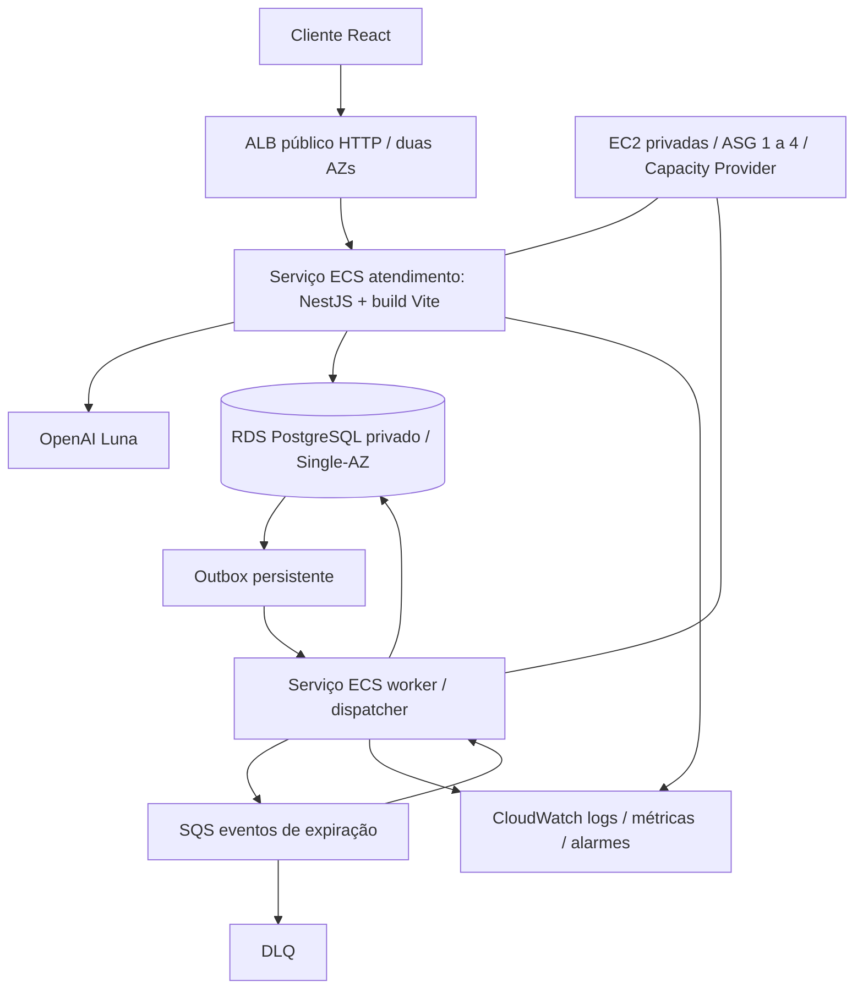

# Implantação manual em Ohio

Status em 16/11/2026: rede, banco, mensageria, ECS/EC2, imagem, IAM e observabilidade criados em Ohio. Migration e seed concluídos; worker em execução. API ativada com chave OpenAI, jornada real Luna validada. Os mínimos foram elevados temporariamente para 2 durante ensaios e restaurados para 1. O autoscaler pode manter mais tasks/hosts após carga. Não usar Terraform, CloudFormation ou CDK nesta etapa. CLI e console são permitidos. Templates JSON de task definitions são entradas de registro ECS, não provisionam a infraestrutura.

## Antes de criar recursos

1. Abrir o console para login do usuário. Conferir conta e `us-east-2` em todas as telas. Verificar créditos, permissões e quotas reais.
2. Consultar preços regionais e acompanhar EC2/EBS, duas NAT, ALB/LCUs/IPv4, RDS, ECR, Secrets Manager, CloudWatch e tráfego. Os preços consultados indicam base aproximada de US$ 0,1693/h antes de armazenamento, métricas, tráfego e expansão. US$ 100 não limita automaticamente o consumo. O usuário autorizou manter o ambiente ligado, sem desligamento programado.
3. Criar orçamento/alertas em US$ 25, 50, 75 e 90, incluindo previsão. Budget é aviso com atraso de dados, não trava de gastos. Não presumir Free Tier.
4. Manter o ambiente ligado conforme autorização do usuário. NAT/ALB continuam cobrando mesmo sem tasks; RDS parado cobra armazenamento e religa após sete dias. Usuário definiu mínimo 1 para operação; qualquer remoção futura exige confirmar recursos exatos antes de apagar.

## Topologia

## Ordem de construção

### Rede

- VPC `10.42.0.0/16`, DNS habilitado. Escolher duas AZs disponíveis na conta.
- Públicas `10.42.0.0/24` e `10.42.1.0/24`: ALB e um NAT por AZ. Rota padrão para Internet Gateway.
- Privadas de aplicação `10.42.10.0/24` e `10.42.11.0/24`: cada uma com rota padrão para NAT da mesma AZ.
- Privadas de banco `10.42.20.0/24` e `10.42.21.0/24`: sem rota padrão para internet; DB subnet group abrange ambas, mesmo com RDS Single-AZ.
- Endpoint gateway S3 gratuito para reduzir tráfego NAT das camadas ECR/S3, se disponível; não adicionar endpoints pagos sem estimar.
- SG ALB: entrada TCP 80 da internet; saída TCP 32768–65535 somente para o SG das EC2.
- SG EC2: entrada TCP 32768–65535 somente do ALB, para portas dinâmicas da API em modo `bridge`; saída HTTPS 443 via NAT e PostgreSQL 5432 somente ao SG do banco. Sem SSH ou IP público. Worker não publica portas.
- SG DB: entrada 5432 somente das EC2; sem saída para internet.
- Em `bridge`, os SGs são dos hosts. As regras não isolam API e worker entre si; a separação complementar ocorre por IAM, credenciais PostgreSQL e ausência de portas publicadas no worker. IMDSv2 obrigatório, hop limit 1 e bloqueio 169.254.169.254 na cadeia DOCKER-USER protegem as credenciais do host.

### Persistência e mensageria

- RDS PostgreSQL, versão suportada sem Extended Support, `db.t4g.micro`, 20 GiB gp3, Single-AZ, privado, criptografia e backups por 7 dias. Não usar credencial master na aplicação.
- Executar migration e seed como tarefa operacional na rede privada. Aplicar `database-roles.sql` e configurar senhas via Secrets Manager; não colocá-las nos comandos/histórico ou no JSON das tasks.
- Conexão TLS com validação da CA RDS. A imagem inclui o bundle de confiança; `DATABASE_CA_PATH` ativa validação no cliente. A tarefa operacional também define `SSL_CERT_FILE` e `NODE_EXTRA_CA_CERTS` para o bundle: a primeira tentativa do Prisma CLI falhou na cadeia de confiança; a revisão 2 concluiu com código 0 e `bootstrap.completed`, preservando verificação estrita.
- SQS Standard `reservation-events`, visibility timeout 30 segundos, long polling 10 segundos, retenção 4 dias; DLQ `reservation-dlq`, retenção 14 dias e redrive após 5 recebimentos. Sem payload com nome ou tokens.
- Segredos separados: URL DB API, URL DB worker e chave OpenAI. SDK AWS usa task role, nunca access key nas tasks.

### IAM

- Role EC2: registro ECS, pull necessário ao agente e Session Manager, com instance profile.
- Execution roles: ECR pull, escrita nos log groups pré-criados e somente os segredos daquela task. KMS decrypt apenas se chave própria exigir.
- Task role API: não precisa de SQS, Secrets Manager ou administração AWS se segredos forem injetados pelo ECS. Manter sem permissões de administração.
- Task role worker: SendMessage, ReceiveMessage, DeleteMessage e atributos necessários apenas na fila principal; não dar `sqs:*` em `*`.
- Logs via driver awslogs; EMF é extraído dos logs, sem necessidade de `cloudwatch:PutMetricData` pela aplicação.
- Separar permissões humanas de provisionamento das permissões de runtime.

### Imagem, EC2 e ECS

- Criar ECR em Ohio com scan habilitado e tags imutáveis. Construir `linux/amd64` para T3; publicar e registrar digest, sem segredos na imagem.
- AMI ECS-optimized Amazon Linux 2023 **x86_64**, obtida por parâmetro SSM regional. Não usar AMI antiga copiada.
- Launch Template `t3.small`, volume gp3 pequeno, IAM profile, IMDSv2 obrigatório e `ecs-user-data.sh` com cluster correto.
- ASG nas duas sub-redes privadas: min 1, desejado 1 e max 4; health EC2 e políticas de substituição. Não parar manualmente hosts fora do controle do ASG.
- Capacity Provider associado ao ASG, managed scaling, managed draining e proteção de término configurada de forma coerente. Serviços usam a estratégia do Capacity Provider, sem Fargate.
- Rede `bridge` com porta dinâmica da API, target group `instance`. Evita o limite baixo de tasks `awsvpc` das T3 pequenas. A instância inicial registrou 2.048 unidades de CPU e 1.657 MiB disponíveis ao ECS após reserva de 256 MiB para o host. Com reserva de 512 MiB por task, cabem no máximo três tasks por host por memória; dez tasks exigem quatro hosts, antes de considerar substitutas e uso real. Medir antes de afirmar capacidade sustentada.
- API min 1/max 6; worker min 1/max 4. Ambos com CPU 256, memoryReservation 512, memory 512. Medir picos antes de fechar estes números. Reservar recursos para SO/agentes.
- Posicionamento deve equilibrar disponibilidade e empacotamento; verificar relação entre `spread`, `binpack` e target capacity do Capacity Provider na configuração efetiva. No ensaio de falha, garantir duas API tasks em EC2/AZs diferentes.
- Templates `task-api.json`/`task-worker.json` contêm `REPLACE_...`: preencher IDs reais antes de registrar. Não executam nada sozinhos.
- Deploy: mínimo saudável 100%, máximo 200%, circuit breaker com rollback; validar capacidade extra para iniciar substitutas. Drenagem do target group 120s e stopTimeout 120s; chat tem timeout total 90s. Requests interrompidos devem poder ser retomados sem duplicar reservas.

### ALB

- ALB internet-facing nas duas públicas, listener HTTP 80, target group tipo `instance`, porta dinâmica no host e porta 3000 dentro do container.
- Health check `/health/ready`; liveness do container `/health/live`. Falha da IA não deve provocar substituição de todas as tasks.
- Idle timeout suficiente para streaming (120s); aplicação emite keep-alive. SG impede acesso direto às tasks.
- `WEB_ORIGIN=http://DNS_REAL_DO_ALB`, `TRUST_ALB=true`, porta 3000. Sem domínio/certificado nesta etapa. HTTP não protege tokens em trânsito; somente dados fictícios na demonstração. Não apresentar como segurança de produção.

### Observabilidade e escala

- Log groups `/periferia/api` e `/periferia/worker`, retenção 30 dias.
- Dashboard: ALB latência/5xx/healthy hosts; ECS running/pending/CPU/memória; ASG desired/in-service; RDS CPU/memória/conexões/storage; SQS backlog/idade/DLQ e métricas EMF de reservas/outbox/atraso.
- Alarmes: healthy targets insuficientes, tasks abaixo do desejado, CPU/memória sustentadas, ASG sem capacidade, ALB 5xx, DLQ >0, idade/backlog, expiração >30s, falhas da aplicação e pouco espaço no banco. Memória por host requer agente adicional; não afirmar que existe sem habilitar.
- Alvos iniciais: API 300 requisições/alvo/minuto, worker 10 mensagens visíveis/task; cooldown de saída 60 s e entrada 300 s. Worker usa matemática SQS / RunningTaskCount; mínimo 1 evita divisão por zero em operação estável, mas ausência de métricas durante falha exige alarme separado. Políticas do worker e da API aplicadas; histórico comprovou API 1→3→2→1 e EC2 1→3. EC2 pelo Capacity Provider, targetCapacity 100. São hipóteses a calibrar, não resultados de carga.
- Avaliar créditos CPU de EC2/RDS burstable para não confundir throttling com falha da aplicação nem gerar cobrança de créditos sem perceber.

## Chave da IA por último

O usuário preencheu o segredo `periferia/openai` diretamente no Secrets Manager. Um invólucro de formatação foi removido sem exibir a chave. A API carrega o segredo na inicialização; após alterar seu valor é necessário novo deployment. A jornada real com Luna foi validada. Não expor em chat, `.env` versionado, Dockerfile ou frontend. Executar teste real de ferramentas e validação adversarial. Mock só é permitido localmente; não satisfaz a apresentação final.

## Inventário da conta

Conta/região; VPC; AZs/subnets/rotas/NAT/EIPs; SGs; cluster; launch template/versão; ASG/Capacity Provider; ECR/digest; task definitions/revisões; serviços; ALB/target group/DNS; endpoint RDS e IDs de segredos (sem valores); SQS/DLQ ARN/URL; IAM roles; log groups; dashboard/alarmes; custos e evidências.

IDs reais e revisões: `aws-inventory.json`. Os arquivos `*-ohio.json` registram definições de tarefas e o modelo operacional de serviço, com mínimo/desejado inicial 1; a criação original da API usou 0 até a chave ser configurada. São entradas para comandos manuais da CLI; não há Terraform, CloudFormation ou CDK nesta etapa. O serviço de API foi criado inicialmente com desejado 0 e ativado após preencher o segredo. O estado operacional acordado é API 1–6, worker 1–4 e EC2 1–4.

Alarmes e orçamento publicam em `periferia-alertas`. Não há assinatura externa configurada: a existência do tópico não equivale a notificação por e-mail entregue. Consultar os estados no CloudWatch.
